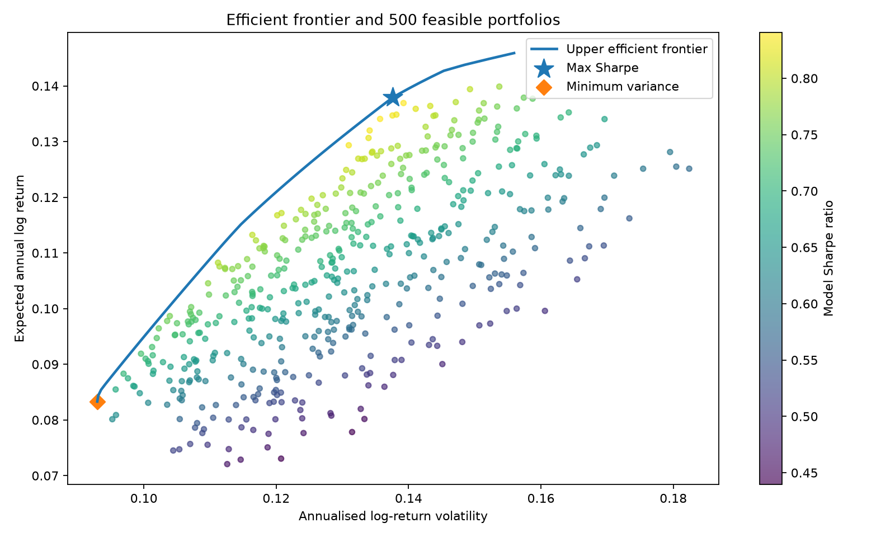
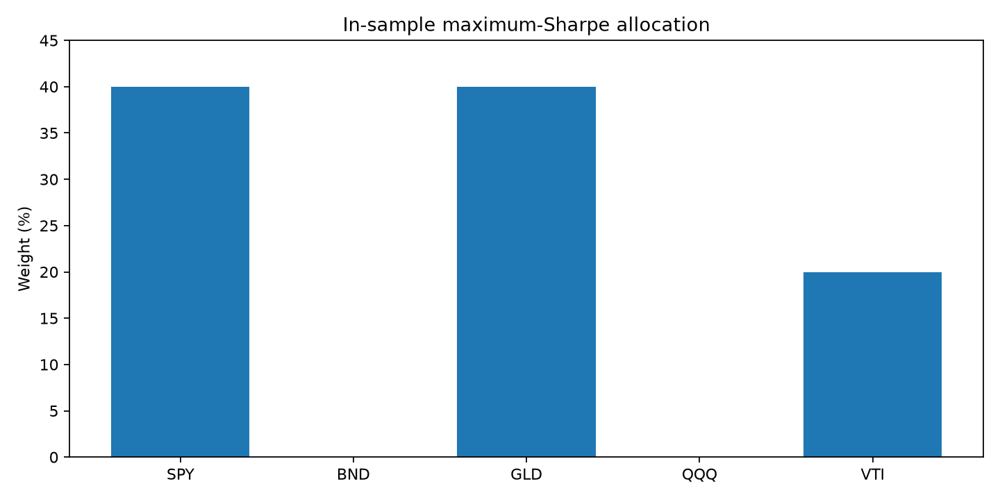
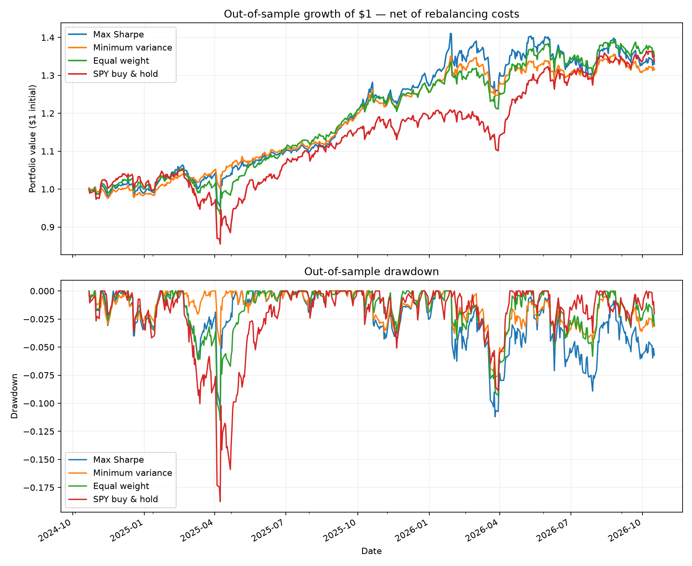

# Portfolio Optimisation: Modern Portfolio Theory and Walk-Forward Backtesting

**Python | Quantitative Finance | Portfolio Construction | Risk Analysis**

## Overview

This project develops and evaluates a constrained portfolio optimisation framework using five exchange-traded funds (ETFs): **SPY, BND, GLD, QQQ and VTI**. It applies Modern Portfolio Theory (MPT) to construct maximum-Sharpe and minimum-variance portfolios, visualises the efficient frontier, and tests whether optimised allocations remain effective **out of sample** after accounting for rebalancing costs.

Rather than judging a strategy solely by its in-sample optimal weights, the project compares three portfolio approaches against a passive S&P 500 ETF benchmark using rolling historical estimation and a walk-forward backtest.

## Research Question

**Do portfolios optimised on historical return and covariance estimates deliver better out-of-sample risk-adjusted performance than simpler allocations?**

## Data and Tools

- **Assets:** SPY (S&P 500 equities), BND (US bonds), GLD (gold), QQQ (Nasdaq-100 equities) and VTI (US total equity market).
- **Price data:** Approximately five years of adjusted daily closing prices downloaded from Yahoo Finance using `yfinance`.
- **Libraries:** `pandas`, `numpy`, `scipy`, `matplotlib`, `yfinance`.
- **Optimisation:** SciPy's Sequential Least Squares Programming (**SLSQP**) with feasibility checks and multiple starting points. Linear programming is used to determine the highest feasible expected-return endpoint of the frontier.

## Methodology

### 1. Return estimation and constrained optimisation

Calculate daily logarithmic returns, annualise their historical mean and covariance, and use these estimates for the in-sample MPT model:

\[
\mu_p=\mathbf{w}^{\mathsf T}\boldsymbol\mu,\qquad
\sigma_p=\sqrt{\mathbf{w}^{\mathsf T}\Sigma\mathbf{w}},\qquad
S_p=\frac{\mu_p-r_f}{\sigma_p}.
\]

Optimise for **maximum Sharpe ratio** or **minimum portfolio variance**, subject to:

- Fully invested portfolio: weights sum to 100%.
- Long-only positions: no negative weights.
- Maximum allocation of **40% per ETF**.
- Illustrative annual risk-free rate of **2%**.

The annualised in-sample expected return is based on *logarithmic* returns, whereas the realised backtest statistics are calculated using *simple* daily returns. These measures should not be interpreted as interchangeable.

### 2. Efficient frontier

Construct the upper efficient frontier by solving constrained minimum-variance problems for a range of target expected returns. Plot **500 randomly sampled feasible portfolios** as comparison points, with the maximum-Sharpe and minimum-variance solutions marked separately. Random sampling is used for visualisation, not to calculate the frontier.





### 3. Walk-forward, out-of-sample evaluation

Compare four strategies:

1. **Maximum Sharpe:** Re-estimate expected returns and covariance; select the constrained portfolio with the greatest model Sharpe ratio.
2. **Minimum variance:** Minimise predicted portfolio variance under the same weight constraints.
3. **Equal weight:** Allocate 20% to each of the five ETFs, with periodic rebalancing.
4. **SPY buy-and-hold:** Uncapped benchmark exposure, without quarterly portfolio rebalancing.

The backtest uses a **rolling three-trading-year estimation window (756 trading days)** and rebalances the first three strategies approximately **quarterly (every 63 trading days)**. Each rebalance uses only data available in its preceding training window, reducing look-ahead bias.

Trading costs are modelled at **10 basis points per dollar traded**, with a self-financing calculation that accounts for fees when solving for post-trade holdings. Between rebalances, portfolio weights drift with market returns.

### 4. Risk measurement and robustness checks

Measure realised **CAGR, annualised volatility, Sharpe ratio, maximum drawdown, historical one-day 95% Value at Risk (VaR), historical one-day 95% Conditional Value at Risk (CVaR), downside deviation, terminal wealth and turnover**.

Further checks include the worst realised 63-trading-day window for the SPY benchmark (with all strategies compared over the same dates), and backtest sensitivity to **0, 10 and 25 bps** transaction costs. The notebook also contains numerical assertions and synthetic transaction-cost checks.

## Results

**Out-of-sample backtest:** 22 October 2024 to 16 October 2026 (498 trading-day observations in the supplied export). Results below come from `out_of_sample_performance.csv` and use the baseline **10 bps** cost assumption.

| Strategy | CAGR | Annualised volatility | Sharpe ratio | Maximum drawdown | Terminal wealth ($1 initial) |
|---|---:|---:|---:|---:|---:|
| Maximum Sharpe | 15.52% | 14.75% | 0.92 | -11.21% | $1.330 |
| **Minimum variance** | 14.86% | **9.72%** | **1.27** | **-7.88%** | $1.315 |
| Equal weight | **16.42%** | 12.72% | 1.10 | -11.52% | **$1.351** |
| SPY buy-and-hold | 15.81% | 16.57% | 0.85 | -18.76% | $1.337 |

**Main findings:**

- **Minimum variance had the highest realised Sharpe ratio** (1.27), compared with maximum Sharpe (0.92) and equal weight (1.10). It also recorded the lowest volatility and smallest maximum drawdown across all four strategies.
- **Equal weight delivered the highest CAGR and terminal wealth**, so the minimum-variance strategy did not lead on absolute return.
- The maximum-Sharpe optimiser did **not** achieve the best out-of-sample risk-adjusted result. This is consistent with the potential sensitivity of mean-variance optimisation to estimated expected returns; the backtest alone does not establish the cause.
- Transaction-cost sensitivity is explicitly examined rather than assuming free rebalancing.

### Portfolio allocation and performance charts

The in-sample maximum-Sharpe solution assigned **40% SPY, 40% GLD and 20% VTI**, with zero weight on BND and QQQ for that particular estimation sample.



### Transaction-cost sensitivity

The table reports out-of-sample **CAGR**, recalculated under different assumed costs per dollar traded:

| Strategy | 0 bps | 10 bps | 25 bps |
|---|---:|---:|---:|
| Maximum Sharpe | 15.81% | 15.52% | 15.08% |
| Minimum variance | 14.95% | 14.86% | 14.72% |
| Equal weight | 16.51% | 16.42% | 16.30% |
| SPY buy-and-hold | 15.87% | 15.81% | 15.72% |

## Repository Contents

```text
Portfolio-Optimization/
├── README.md
├── portfolio_optimization.ipynb
└── portfolio_results/
    ├── efficient_frontier.png
    ├── optimal_weights.png
    ├── out_of_sample_performance.png
    ├── out_of_sample_performance.csv
    ├── transaction_cost_sensitivity.csv
    ├── allocation_history.csv
    ├── transaction_log.csv
    ├── adjusted_prices.csv
    ├── daily_log_returns.csv
    ├── out_of_sample_daily_nav.csv
    └── out_of_sample_daily_returns.csv
```

The notebook generates its output directory and writes the reported charts and audit CSVs when run. Ensure these files are uploaded under the paths shown above for the README's embedded charts to render on GitHub.

## How to Run

1. Clone or download the repository.
2. Open `portfolio_optimization.ipynb` in Jupyter Notebook or JupyterLab.
3. Install dependencies if needed:

   ```bash
   pip install numpy pandas scipy matplotlib yfinance
   ```

4. Run all notebook cells sequentially. An internet connection is required for downloading the fixed historical period from Yahoo Finance.
5. Inspect the generated `portfolio_results/` directory for figures, CSV exports and diagnostics.

**Reproducibility:** The notebook requests the fixed historical window 18 October 2021 through 16 October 2026 (the download end date is exclusive). Yahoo Finance may revise adjusted prices or data coverage, so reruns are not guaranteed to reproduce the published results exactly. The included CSVs preserve the historical run reported here. No local CSV is required to execute the notebook.

## Limitations

- Historical five-ETF results over roughly two years of out-of-sample observations may not generalise to different market regimes.
- SPY, QQQ and VTI share substantial US equity exposure, limiting true diversification across some holdings.
- Estimates of expected returns and covariance can be unstable, particularly for maximum-Sharpe optimisation.
- Transaction costs are illustrative and exclude bid-ask spreads, market impact and taxes; fractional ETF holdings and adjusted-close execution are simplifying assumptions.
- Using today's chosen ETFs retrospectively may introduce selection bias.
- The risk-free rate is fixed at an illustrative value rather than matched to historical daily rates.
- SLSQP multistart and feasibility checks improve numerical robustness but do not prove global optimality.

**This project is a historical research exercise, not investment advice or a forecast of future returns.**
